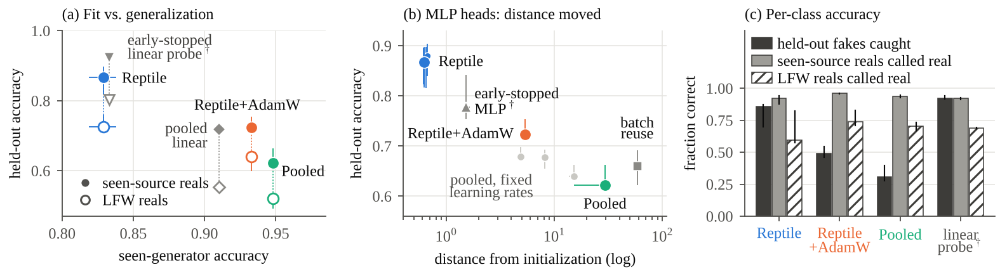
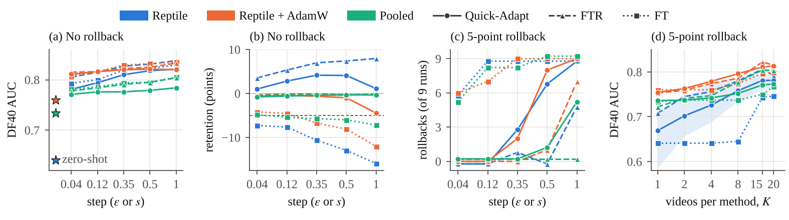

# RR-EFL and Quick-Adapt: few-shot deepfake detection on a frozen CLIP backbone

Code and complete run logs for the paper

> Ahsan Ali and Ng S. T. Chong, "Round-Robin Episodic Few-Shot Learning for Generalizable Deepfake Detection with Rapid Adaptation," in *Proc. IEEE International Workshop on Information Forensics and Security (WIFS)*, Sendai, Japan, December 2026.

A deployed deepfake detector meets generators it was never trained on and can at best be given a few labeled examples of each. We study this setting with a frozen CLIP ViT-L/14 backbone and a small detector head trained with first-order Reptile, and with **Quick-Adapt**, which adapts the head from a few labeled videos while replaying earlier training data and rolls back if accuracy on the earlier generators drops by more than 5 points.




## Contents

| Path | What it is |
|---|---|
| `RREFL_R3_final.ipynb` | The complete experiment, executed end to end on one NVIDIA L4. Its printed outputs are the run logs that every number in the paper comes from. |
| `scripts/nb_data.json` | The numbers behind Fig. 1 and Fig. 2, extracted from the notebook's printed tables. |
| `scripts/parse_nb.py` | Re-extracts `nb_data.json` from the executed notebook. No number is typed in by hand. |
| `scripts/make_figures.py` | Draws Fig. 1 and Fig. 2 from `nb_data.json`. |
| `figures/` | Fig. 1 (`fig_base.pdf`) and Fig. 2 (`fig_adapt.pdf`) exactly as in the paper, plus PNG previews. |

## Reproducing the paper

There are two levels.

**1. Check the figures (seconds, no GPU).** Redraw both figures from the logged results:

```bash
pip install numpy matplotlib
python scripts/parse_nb.py RREFL_R3_final.ipynb scripts/nb_data.json   # optional: re-extract the numbers from the notebook
python scripts/make_figures.py                                           # writes figures/fig_base.pdf and figures/fig_adapt.pdf
```

With the Liberation Serif font installed, the output is pixel-identical to the figures in the paper. Without it, the text falls back to DejaVu Serif and only the font changes.

**2. Re-run everything (about 20 hours on one NVIDIA L4).** Run the notebook from top to bottom in Google Colab (see [Running the notebook](#running-the-notebook)).

### Where each result comes from

Section numbers (§) refer to the notebook's headings; tables are printed in §19.

| Paper item | Produced by | Output |
|---|---|---|
| Table I: base models | §19, `Table 1` | Notebook output |
| Table II: DF40 adaptation, K = 15 | §19, `Table 2` (DF40 block) | Notebook output |
| Fig. 1: base models | `scripts/make_figures.py`, data from `Table 1` | `figures/fig_base.pdf` |
| Fig. 2: adaptation to DF40 | `scripts/make_figures.py`, data from `Tables 2, 4, 5` (DF40) and the rollback counts in §20.4 | `figures/fig_adapt.pdf` |
| Sec. V-B: paired base-model comparison after adaptation | §19, `Table 3b` (DF40) | Notebook output |
| Sec. V-B: per method and per seen generator | §19, `Tables 6 and 7` | Notebook output |
| Sec. V-B: cost | §20.1 (feature extraction) and the methods facts at the end of §19 (one Quick-Adapt run) | Notebook output |
| Sec. V-C: step-size sweep | §19, `Table 5` (DF40); rollback counts in §20.4 and §20.5a | Notebook output |
| Sec. V-C: support-size sweep (K = 1 to 20) | §19, `Table 4` (DF40) | Notebook output |
| Sec. V-C: held-out generator as a second target | §19, `Table 2` (SFHQ block) | Notebook output |
| Sec. VI: file-metadata shortcut | §5, data checks | Notebook output |
| Sec. VI: DeepSpeak bitrate check | §20.5b | Notebook output |
| Integrity checks (budgets, invariants, completeness) | §19, `Table 8` and the completeness check | Notebook output |

Results are reported as median [min, max] over 3 seeds (base models) or 9 runs (adapted models: 3 seeds × 3 support draws).

## Running the notebook

- **Hardware:** Google Colab with one NVIDIA L4 GPU and roughly 70–90 GB of free disk for the first session. Tested with PyTorch 2.11.0 (CUDA 13.0) and Kaggle CLI 2.2.4. On another GPU, the last digits of the results can differ.
- **Kaggle:** add your Kaggle API token as the Colab Secret `KAGGLE_KEY` (key icon in the left sidebar, with Notebook access switched on). The notebook downloads the Kaggle datasets itself.
- **DF40:** before running, put the DF40 Celeb-DF-domain zips in Google Drive as `MyDrive/DF40/{inswap,simswap,e4s,wav2lip,sadtalker,lia}.zip`, and the Celeb-DF v2 real videos as `MyDrive/Celeb-DF-v2_real_data_for_DF40.zip`.
- **DeepSpeak (optional):** `RUN_DEEPSPEAK = True` in the first cell needs granted access to the gated dataset and a Hugging Face token as the Colab Secret `HF_TOKEN`; the notebook checks this at the start and stops if access is missing. Without access, set `RUN_DEEPSPEAK = False`. The paper reports no DeepSpeak adaptation results; DeepSpeak is used only for the bitrate check in Sec. VI.
- **Outputs:** results go to Google Drive under `MyDrive/RREFL_R3/runs_final/` and `MyDrive/RREFL_R3/report_final/` (set by `RESULTS_TAG`). CLIP features are cached in `MyDrive/RREFL_R3/features/`, so later sessions skip the download and the extraction. Finished runs are skipped when the notebook is restarted.
- **Smoke test:** set `SMOKE_TEST = True` in the first cell to run the whole pipeline on tiny synthetic data in a few minutes, so you can check the setup before the full run.

## Data

No dataset is redistributed here; each keeps its own license and terms of use.

| Role | Dataset | Source |
|---|---|---|
| Training (GAN) | StyleGAN, from "140k real and fake faces" | [kaggle: xhlulu/140k-real-and-fake-faces](https://www.kaggle.com/datasets/xhlulu/140k-real-and-fake-faces) |
| Training (GAN) | ProGAN | [kaggle: unknownmemberf/progan](https://www.kaggle.com/datasets/unknownmemberf/progan) |
| Training (face swap) | OpenForensics | [kaggle: manjilkarki/deepfake-and-real-images](https://www.kaggle.com/datasets/manjilkarki/deepfake-and-real-images) |
| Training (face swap) | FaceForensics++ Deepfakes, c23 | [kaggle: gradientvoyager/faceforensics-c23-extracted-faces-100k](https://www.kaggle.com/datasets/gradientvoyager/faceforensics-c23-extracted-faces-100k) |
| Training (diffusion) | Stable Diffusion 1.5 | [kaggle: mohannadaymansalah/stable-diffusion-dataaaaaaaaa](https://www.kaggle.com/datasets/mohannadaymansalah/stable-diffusion-dataaaaaaaaa) |
| Held-out generator (never trained on) | SFHQ-T2I: FLUX.1 and DALL-E 3 (SDXL excluded) | [kaggle: selfishgene/sfhq-t2i-synthetic-faces-from-text-2-image-models](https://www.kaggle.com/datasets/selfishgene/sfhq-t2i-synthetic-faces-from-text-2-image-models) |
| Never-seen real faces | Labeled Faces in the Wild (LFW) | [kaggle: jessicali9530/lfw-dataset](https://www.kaggle.com/datasets/jessicali9530/lfw-dataset) |
| External video target | DF40, Celeb-DF domain: InSwap, SimSwap, E4S, Wav2Lip, SadTalker, LIA | [github.com/YZY-stack/DF40](https://github.com/YZY-stack/DF40) |
| Real videos for DF40 | Celeb-DF v2 | [github.com/yuezunli/celeb-deepfakeforensics](https://github.com/yuezunli/celeb-deepfakeforensics) |
| Limitations check only | DeepSpeak v2.0 (gated) | [huggingface: faridlab/deepspeak_v2](https://huggingface.co/datasets/faridlab/deepspeak_v2) |

## Citation

```bibtex
@inproceedings{ali2026rrefl,
  author    = {Ali, Ahsan and Chong, Ng S. T.},
  title     = {Round-Robin Episodic Few-Shot Learning for Generalizable Deepfake Detection with Rapid Adaptation},
  booktitle = {Proc. IEEE International Workshop on Information Forensics and Security (WIFS)},
  address   = {Sendai, Japan},
  year      = {2026}
}
```

## License

The code is released under the MIT License (see `LICENSE`). Datasets are not included and remain under their own terms.

## Acknowledgement

The authors thank the United Nations University for institutional support and for providing the research environment in which this work was conducted.
